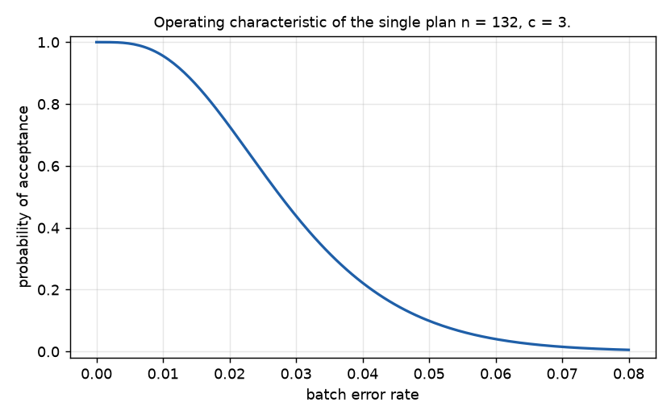

# qasample

Acceptance sampling for data quality: choose how many records of a batch to inspect and what error
count to tolerate, with the risks stated, and bound the batch's error rate from the sample.

## Why this is hard

Checking every record of a labelled batch costs too much, and checking "a few" gives no stated
risk. How many records are enough depends on the size of the batch, on the error rate that is
acceptable, on the error rate that must be caught, and on how often each of the two wrong decisions
may happen. Stopping an inspection early because it looks fine changes those risks unless the plan
was built to allow it, and an inspector who misses errors shifts them again. The arithmetic is
old and well understood in manufacturing; it is rarely applied to datasets.

## Install

```
pip install git+https://github.com/vipul21435/qasample
```

Python 3.10 or later, no runtime dependencies. Only `qasample oc --chart` needs matplotlib.

## Quickstart

Plan an audit of a batch of 8000 records that should pass at 1 % errors and must be caught at 5 %:

```
$ qasample plan --acceptable 0.01 --rejectable 0.05 --batch 8000 --double
Single plan (hypergeometric model): inspect n = 132 records, accept if at most c = 3 are bad.

| batch error rate | requirement | P(accept) |
| --- | --- | --- |
| 0.0100 | >= 0.9500 | 0.9572 |
| 0.0500 | <= 0.1000 | 0.0973 |

Batch of 8000: the acceptable batch holds 80 bad records, the rejectable one 400.
Under rectification the average outgoing error rate is at most 0.0146 (reached with 177 bad records in the batch).

Double plan (hypergeometric model): inspect n1 = 68; accept if at most c1 = 0 are bad, reject if 4 or more; otherwise inspect n2 = 68 more and accept if the total is at most c2 = 3.

| batch error rate | P(accept) | average records inspected | single plan n |
| --- | --- | --- | --- |
| 0.0100 | 0.9555 | 101.4507 | 132 |
| 0.0500 | 0.0990 | 103.7468 | 132 |
```

After the audit, 2 of the 130 inspected records were bad:

```
$ qasample bound --n 130 --bad 2 --batch 8000 --target 0.05
2 bad of 130 inspected: observed error rate 0.0154.

| bound at confidence 0.9500 | low | high |
| --- | --- | --- |
| Clopper-Pearson, two-sided | 0.00187 | 0.05447 |
| Clopper-Pearson, one-sided upper | 0 | 0.04764 |
| Wilson score, two-sided (approximate) | 0.00423 | 0.05436 |

Batch of 8000 (hypergeometric): between 16 and 433 bad records in all, so between 14 and 431 among the 7870 not inspected; one-sided, at most 377 left.

Probability that the batch error rate is at most 0.0500 (uniform prior): 0.9635.
```

`bound` also reads the inspected records themselves (`--input audit.jsonl --column result`; JSONL
or CSV). A value of `pass`, `ok`, `good`, `correct`, `0`, `false`, `no` or an empty cell is a good
record; anything else is a bad one and is counted as its error category. `--bad-values` and
`--good-values` change that.

Inspect one record at a time and stop as soon as the evidence is enough:

```
$ qasample sequential --acceptable 0.01 --rejectable 0.05 --truncate 400
Sequential plan: after n records with d bad, accept if d <= -1.3639 + 0.02499 n, reject if d >= 1.7510 + 0.02499 n, otherwise inspect another record.
A clean run is accepted after 55 records. Truncated at 400 records (then decided by the sign of the log likelihood ratio).

Decision numbers, listed where they change:

| n | accept if d <= | reject if d >= |
| --- | --- | --- |
| 1 | - | - |
| 2 | - | 2 |
| 10 | - | 3 |
| 50 | - | 4 |
| 55 | 0 | 4 |
| 91 | 0 | 5 |
| 95 | 1 | 5 |
| 131 | 1 | 6 |
| 135 | 2 | 6 |
| 165 | 2 | 6 |

Exact operating characteristic, with Wald's approximation beside it:

| error rate | P(accept) | average records | approx. P(accept) | approx. average |
| --- | --- | --- | --- | --- |
| 0 | 1.0000 | 55.0000 | 1.0000 | 54.5861 |
| 0.0100 | 0.9706 | 85.0215 | 0.9500 | 80.6192 |
| 0.0250 | 0.5968 | 116.5357 | 0.5621 | 98.0306 |
| 0.0500 | 0.1006 | 71.0023 | 0.1000 | 57.5477 |
```

Split 200 inspections over two sources of different quality:

```
$ qasample stratify --sizes reviewed=5000,scraped=3000 --total 200 --method neyman --prior reviewed=0.01,scraped=0.08
Allocation of 200 inspections (neyman):

| stratum | size | prior rate | inspect |
| --- | --- | --- | --- |
| reviewed | 5000 | 0.0100 | 76 |
| scraped | 3000 | 0.0800 | 124 |
```

With `--input` and `--stratum`, `stratify` combines a finished audit into one estimate with its
interval. The operating characteristic of any single plan:

```
$ qasample oc --n 132 --c 3 --max-rate 0.08 --points 9 --chart docs/oc_132_3.png
Operating characteristic of the single plan n = 132, c = 3.

| error rate | P(accept) | AOQ |
| --- | --- | --- |
| 0 | 1.0000 | 0 |
| 0.0100 | 0.9557 | 0.0096 |
| 0.0200 | 0.7281 | 0.0146 |
| 0.0300 | 0.4384 | 0.0132 |
| 0.0400 | 0.2221 | 0.0089 |
| 0.0500 | 0.0992 | 0.0050 |
| 0.0600 | 0.0403 | 0.0024 |
| 0.0700 | 0.0152 | 0.0011 |
| 0.0800 | 0.0054 | 0.0004 |

Chart written to docs/oc_132_3.png.
```



An inspector who misses one bad record in five:

```
$ qasample plan --acceptable 0.01 --rejectable 0.05 --miss-rate 0.2
Single plan (binomial model): inspect n = 132 records, accept if at most c = 3 are bad.

| batch error rate | requirement | P(accept) |
| --- | --- | --- |
| 0.0100 | >= 0.9500 | 0.9557 |
| 0.0500 | <= 0.1000 | 0.0992 |

Under rectification the average outgoing error rate is at most 0.0147 (reached at an incoming rate of 0.0222).

Inspector with miss rate 0.2000 and false alarm rate 0: a batch at 0.0100 looks like 0.0080, one at 0.0500 looks like 0.0400.

| plan | n | c | real producer risk | real consumer risk |
| --- | --- | --- | --- | --- |
| designed for a perfect inspector | 132 | 3 | 0.0221 | 0.2221 |
| designed for this inspector | 166 | 3 | 0.0452 | 0.0979 |
```

`oc --double-plan n1,c1,r1,n2,c2` tabulates a double plan, `sequential --rates` chooses the rates
of the exact table, and `bound --calibration missed,known_bad,false_alarms,known_good` widens the
interval for an inspector whose error rates were themselves estimated on records with known
answers. Every command takes `--format json` and can be run as `python -m qasample`. The same
functions are available from Python; see `examples/quickstart.py`.

## How it works

**Two models.** For a batch that is large next to the sample, the number of bad records X in a
sample of n is binomial, P(X = k) = C(n, k) p^k (1 - p)^(n - k). For a finite batch of N records
holding D bad ones, sampled without replacement, it is hypergeometric,
P(X = k) = C(D, k) C(N - D, n - k) / C(N, n). Both are computed in pure Python; tails are summed
term by term away from the mode, so a small tail is never obtained as one minus a number close to
one.

**Single plans.** Inspect n records and accept if X <= c. The operating characteristic is
Pa(p) = P(X <= c). A plan meets the requirement when Pa(p0) >= 1 - alpha at the acceptable rate p0
(producer risk alpha) and Pa(p1) <= beta at the rejectable rate p1 (consumer risk beta). For a
finite batch the two rates become whole numbers of bad records, D0 = floor(N p0) and
D1 = ceil(N p1). The search raises c from 0; for each c it finds by bisection the smallest n with
Pa(p1) <= beta (Pa falls as n grows) and stops at the first c for which that n also satisfies
the producer. This is the smallest n of any plan that meets both risks: the smallest n allowed by
the consumer does not decrease with c, and for a fixed c a larger n only hurts the producer. The
tests compare the result with exhaustive enumeration.

Under rectification (a rejected batch is inspected in full and its bad records replaced) the
average outgoing quality is AOQ = p Pa(p) (N - n) / N and the average total inspection is
ATI = n + (1 - Pa(p)) (N - n); AOQL is the largest AOQ over all p. These are the definitions of
the [NIST handbook, section 6.2.2](https://www.itl.nist.gov/div898/handbook/pmc/section2/pmc22.htm).
For a finite batch the exact AOQ is the sum over d <= c of P(X = d) (D - d) / N.

**Double plans.** Inspect n1 and count d1; accept if d1 <= c1, reject if d1 >= r1, otherwise
inspect n2 more and accept if d1 + d2 <= c2
([NIST handbook, section 6.2.4](https://www.itl.nist.gov/div898/handbook/pmc/section2/pmc24.htm)).
The acceptance probability is P(d1 <= c1) plus the sum over c1 < d1 < r1 of
P(d1) P(d2 <= c2 - d1), and the average sample number is n1 + n2 P(c1 < d1 < r1); both are computed
exactly, under either model. `find_double_plan` searches plans with n2 = n1 or n2 = 2 n1 and
r1 = c2 + 1, and keeps the one with the smallest average sample number at the acceptable rate.

**Sequential plan.** Wald's sequential probability ratio test (A. Wald, "Sequential Tests of
Statistical Hypotheses", Annals of Mathematical Statistics 16(2), 1945, 117-186,
doi:10.1214/aoms/1177731118; reference as listed on
[this page](https://en.wikipedia.org/wiki/Sequential_probability_ratio_test)). After n records
with d bad the log likelihood ratio of p1 against p0 is d ln(p1 / p0) + (n - d) ln((1 - p1) / (1 - p0)).
Inspection stops with acceptance when it is at most ln(beta / (1 - alpha)) and with rejection when
it is at least ln((1 - beta) / alpha). In the (n, d) plane these are two parallel lines: accept when
d <= -h0 + s n, reject when d >= h1 + s n, with k = ln(p1 (1 - p0) / (p0 (1 - p1))),
h0 = ln((1 - alpha) / beta) / k, h1 = ln((1 - beta) / alpha) / k and
s = ln((1 - p0) / (1 - p1)) / k (the same lines as in the
[NIST handbook, section 6.2.6](https://www.itl.nist.gov/div898/handbook/pmc/section2/pmc26.htm)).
The thresholds are approximate, because the count steps over a line instead of landing on it, so
alpha and beta are nominal. `SequentialPlan.exact` therefore carries the probability of every
(n, d) state forward and reports the real acceptance probability and average sample number, for
the binomial model or for a finite batch, with or without truncation. A truncated run that is
still undecided at the last record is settled by the sign of the log likelihood ratio. Wald's
closed-form approximations (`wald_oc`, `wald_asn`) are provided for comparison; in the quickstart
table above the exact average sample number is up to 23 % larger than the approximation (71.0
against 57.5 records at the rejectable rate).

**Bounds from a sample.** With k bad of n, the Clopper-Pearson lower bound L solves
P(X >= k | L) = alpha / 2 and the upper bound U solves P(X <= k | U) = alpha / 2 (C. Clopper and
E. S. Pearson, "The use of confidence or fiducial limits illustrated in the case of the binomial",
Biometrika 26(4), 1934, 404-413). The Wilson score interval is
(p + z^2 / 2n +- z sqrt(p (1 - p) / n + z^2 / 4n^2)) / (1 + z^2 / n) (E. B. Wilson, "Probable
inference, the law of succession, and statistical inference", Journal of the American Statistical
Association 22(158), 1927, 209-212). Both references are as listed on
[this page](https://en.wikipedia.org/wiki/Binomial_proportion_confidence_interval), which also
describes the rule of three: with no bad record among n the exact upper bound is
1 - alpha^(1 / n), close to -ln(alpha) / n, which is 3 / n at 95 %. For a finite batch the bounds
are on the number of bad records D: the upper one is the largest D with
P(X <= k | N, D, n) > alpha / 2, the lower one the smallest D with P(X >= k | N, D, n) > alpha / 2;
subtracting k bounds what is left among the uninspected. The probability of meeting a target uses
a Beta(1, 1) prior on the error rate, so the posterior is Beta(1 + k, 1 + n - k); for a finite
batch the bad records among the uninspected follow the matching beta-binomial distribution.

**Stratified audits.** Proportional allocation gives stratum h a share of the sample proportional
to its size N_h; Neyman allocation uses N_h sqrt(p_h (1 - p_h)) with prior rates p_h, giving more
of the sample to the strata that vary more
([summary](https://en.wikipedia.org/wiki/Stratified_sampling)). The combined estimate is
sum W_h p_h with W_h = N_h / N. Two intervals are reported: the normal approximation with variance
sum W_h^2 (1 - n_h / N_h) p_h (1 - p_h) / (n_h - 1), and a conservative one that adds up exact
finite-batch bounds per stratum, each taken at confidence 1 - alpha / H so that all H strata hold
together.

**Imperfect inspector.** If the inspector passes a bad record with probability m and flags a good
one with probability f, a batch with true error rate p shows the apparent rate
q = p (1 - m) + (1 - p) f, and p = (q - f) / (1 - m - f). A plan designed for a perfect inspector
is evaluated at q(p0) and q(p1) to get its real risks, and a corrected plan is designed on those
apparent rates. Bounds on q map to bounds on p through the same formula. When m and f come from a
calibration set, `corrected_bounds_estimated` combines three exact intervals at confidence
1 - alpha / 3 each.

**Replay.** Given a batch whose records carry a known good/bad flag, `replay` draws many audits,
each inspecting records in a fresh random order without replacement exactly as the plan
prescribes, and reports the share of audits that accept next to the probability computed for a
batch of that size with that many bad records.

Sampling plans of this kind were popularized by Dodge and Romig
([NIST handbook, section 6.2.1](https://www.itl.nist.gov/div898/handbook/pmc/section2/pmc21.htm)),
and published attribute-sampling standards such as MIL-STD-105 and ANSI/ASQ Z1.4 tabulate them
([summary](https://en.wikipedia.org/wiki/Acceptance_sampling)). qasample does not reproduce those
tables or their switching rules; it computes plans directly from the two error rates and the two
risks.

**Checks.** `uv run --extra dev pytest -q` runs 234 tests with 99 % line coverage
(`--cov=qasample`). Plans are compared with exhaustive enumeration, tails and intervals with scipy
(a test-only dependency), the sequential and double plans with enumeration of every inspection
order on small batches, with Wald's closed forms and with seeded simulation, and interval coverage
is checked by enumeration and seeded simulation.

## Results on public data

Data: the verification files published with C. G. Northcutt, A. Athalye and J. Mueller,
"Pervasive Label Errors in Test Sets Destabilize Machine Learning Benchmarks", NeurIPS 2021 Track
on Datasets and Benchmarks ([arXiv:2103.14749](https://arxiv.org/abs/2103.14749)), in the
repository [cleanlab/label-errors](https://github.com/cleanlab/label-errors), licence Apache-2.0
as stated on its page. Nothing from that repository is stored here; `examples/fetch_label_errors.py`
downloads the files. For each test set the paper's algorithm flagged candidate label errors and
each candidate then received five votes on its label. Here a record counts as bad when it was
sent for verification and fewer than three of its five votes kept the given label; every record
that was never sent for verification counts as good. The error rates below are therefore lower bounds
on the real ones, and the definition is applied here to the published vote counts rather than
copied from the paper's tables. Six of the ten test sets are used. AudioSet and Amazon Reviews
store their votes in a different layout, and for Caltech-256 and QuickDraw the repository's label
arrays are not marked as a test split, so those four are left out.

```
$ python examples/fetch_label_errors.py data/
| test set | records | sent for verification | bad | error rate |
| --- | --- | --- | --- | --- |
| mnist | 10000 | 100 | 15 | 0.0015 |
| cifar10 | 10000 | 275 | 54 | 0.0054 |
| cifar100 | 10000 | 2235 | 585 | 0.0585 |
| imagenet | 50000 | 5440 | 2916 | 0.0583 |
| imdb | 25000 | 1310 | 725 | 0.0290 |
| 20news | 7532 | 93 | 82 | 0.0109 |
```

Three requirements, each with producer risk 0.05 and consumer risk 0.10 under the binomial model,
and the plans they need:

```
$ python examples/replay_label_errors.py data/ 10000 0
```

| requirement | acceptable | rejectable | single plan | double plan | double: average records at acceptable | sequential: average at acceptable | sequential: average at rejectable |
| --- | --- | --- | --- | --- | --- | --- | --- |
| A | 0.005 | 0.020 | n=462, c=5 | n1=276, c1=2, r1=6, n2=276, c2=5 | 319.7 | 254.9 | 220.7 |
| B | 0.010 | 0.050 | n=132, c=3 | n1=69, c1=0, r1=4, n2=69, c2=3 | 103.2 | 85.1 | 71.0 |
| C | 0.020 | 0.080 | n=98, c=4 | n1=68, c1=2, r1=6, n2=68, c2=5 | 78.4 | 61.5 | 53.9 |

Requirement B, for example, needs 132 records with a single plan; the double plan inspects about
103.2 on average when the batch is at the acceptable rate, and the sequential plan about
85.1.

Accept rate of the single plans over 10,000 random audits of each test set (seed 0), next to the
operating characteristic computed for that batch:

| test set | records | bad | error rate | requirement | replay accept rate | computed, finite batch | computed, binomial |
| --- | --- | --- | --- | --- | --- | --- | --- |
| mnist | 10000 | 15 | 0.0015 | A | 1.0000 | 1.0000 | 0.9999 |
| mnist | 10000 | 15 | 0.0015 | B | 1.0000 | 1.0000 | 0.9999 |
| mnist | 10000 | 15 | 0.0015 | C | 1.0000 | 1.0000 | 1.0000 |
| cifar10 | 10000 | 54 | 0.0054 | A | 0.9645 | 0.9627 | 0.9588 |
| cifar10 | 10000 | 54 | 0.0054 | B | 0.9953 | 0.9945 | 0.9941 |
| cifar10 | 10000 | 54 | 0.0054 | C | 0.9999 | 0.9998 | 0.9998 |
| 20news | 7532 | 82 | 0.0109 | A | 0.6011 | 0.6107 | 0.6107 |
| 20news | 7532 | 82 | 0.0109 | B | 0.9412 | 0.9446 | 0.9430 |
| 20news | 7532 | 82 | 0.0109 | C | 0.9967 | 0.9958 | 0.9955 |
| imdb | 25000 | 725 | 0.0290 | A | 0.0066 | 0.0072 | 0.0076 |
| imdb | 25000 | 725 | 0.0290 | B | 0.4656 | 0.4649 | 0.4653 |
| imdb | 25000 | 725 | 0.0290 | C | 0.8438 | 0.8442 | 0.8438 |
| imagenet | 50000 | 2916 | 0.0583 | A | 0 | 1.512e-07 | 1.652e-07 |
| imagenet | 50000 | 2916 | 0.0583 | B | 0.0478 | 0.0470 | 0.0472 |
| imagenet | 50000 | 2916 | 0.0583 | C | 0.3199 | 0.3172 | 0.3174 |
| cifar100 | 10000 | 585 | 0.0585 | A | 0 | 9.712e-08 | 1.537e-07 |
| cifar100 | 10000 | 585 | 0.0585 | B | 0.0469 | 0.0454 | 0.0464 |
| cifar100 | 10000 | 585 | 0.0585 | C | 0.3124 | 0.3135 | 0.3148 |

The replay rates agree with the computed finite-batch probabilities to within Monte Carlo error:
one standard error is at most 0.005 with 10,000 audits, and the largest difference in the table is
0.0096, for 20news under requirement A, about two standard errors. The pattern is the one the operating characteristic
predicts. MNIST and CIFAR-10, with fewer than 1 % verified errors, are accepted almost always
under B and C. CIFAR-100 and ImageNet, near 5.8 %, are rejected about 95 % of the time under B and
were never accepted under A. IMDB at 2.9 % lies between the acceptable and the rejectable rate of
both B and C, and is accepted 47 % of the time under B and 84 % under C: a plan makes no promise
for a batch between its two rates. The finite-batch and binomial columns differ little here
because every sample is a small fraction of its test set.

The sequential plan for requirement B on the same test sets (10,000 audits, seed 0; computed
values are exact for the finite batch):

| test set | error rate | replay accept rate | computed | replay records per audit | computed records |
| --- | --- | --- | --- | --- | --- |
| mnist | 0.0015 | 1.0000 | 0.9999 | 58.6960 | 58.4777 |
| cifar10 | 0.0054 | 0.9953 | 0.9958 | 69.3082 | 69.3416 |
| 20news | 0.0109 | 0.9617 | 0.9637 | 88.1679 | 88.2806 |
| imdb | 0.0290 | 0.4727 | 0.4702 | 113.4770 | 114.5739 |
| imagenet | 0.0583 | 0.0547 | 0.0547 | 57.9709 | 58.4465 |
| cifar100 | 0.0585 | 0.0538 | 0.0534 | 57.4391 | 58.1117 |

The whole run took about 62 seconds here (measured on a loaded laptop).

## Limitations

- The good/bad flags of the public data are lower bounds: records that were never sent for
  verification are counted as good, and a majority of five votes can itself be wrong.
- Only pass/fail (attribute) plans. No variables plans, no plans with more than two stages, no
  curtailed double sampling, and none of the switching rules or tables of the published standards.
- The double-plan search is restricted to n2 = n1 or 2 n1, r1 = c2 + 1 and c2 at most three above
  the single plan's acceptance number (and at most 12 unless `max_c2` is raised); it is the best
  plan in that family, not among all double plans.
- The sequential plan's alpha and beta are nominal. Read the exact column, and expect truncation
  to raise the risks.
- The inspector correction uses the binomial model only and assumes the inspector's two error
  rates are the same for every record and independent between records.
- Every probability assumes the sample is drawn at random from the batch. A sample taken from the
  top of a file, or chosen by a model, has no stated risk.
- The stratified normal interval is approximate and collapses to a point when no stratum shows a
  mixed sample; the exact one is conservative.
- The probability of meeting a target depends on the prior; only Beta priors are offered and the
  default is uniform.
- A file ending in `.json` is read as JSON lines, one object per line.

## Related tools

- [labelfuse](https://github.com/vipul21435/labelfuse) aggregates several annotators' labels into
  one; qasample then decides how much of the result to check.
- [rubricops](https://github.com/vipul21435/rubricops) covers rubrics and inter-rater agreement,
  which is where an inspector's error rates come from.
- [evalstats](https://github.com/vipul21435/evalstats) gives error bars and paired comparisons for
  evaluation scores.
- [sftlint](https://github.com/vipul21435/sftlint) lints chat and tool-calling datasets
  mechanically, before any sampling is needed.

## Licence

MIT. Copyright (c) 2026 Vipul Raj Jha.

Built by Vipul Raj Jha · https://vipul21435.github.io
